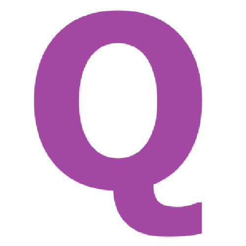

<p align="center">
  
</p>

<h1 align="center">QCode Programming Language</h1>

<p align="center">
  
  
  
</p>

<p align="center">
  <em>Язык программирования с собственной экосистемой</em><br>
  <em>A programming language with its own ecosystem</em>
</p>

---

## RU
**О проекте**

**QCode** — это независимый скриптовый язык программирования, разрабатываемый с упором на простоту освоения и удобство использования для начинающих разработчиков

### Компоненты экосистемы
* **QCode Runtime (`Interpreter2`)** — интерпретатор ядра языка
* **QCode Converter (`Converter`)** — инструмент сборки проектов
* **QIDE** — официальная графическая среда разработки с подсветкой синтаксиса и удобным редактором кода
* **Installer** — графический установщик для быстрой автоматической развертки всех компонентов в системе

## ENG
**About the project**

**QCode** is an independent scripting programming language designed with a focus on ease of learning and usability for beginner developers

### Ecosystem Components
- **QCode Runtime (`Interpreter2`)** — core language interpreter
- **QCode Converter (`Converter`)** — project build and translation tool
- **QIDE** — official graphical development environment featuring syntax highlighting and an intuitive code editor
- **Installer** — GUI installer for fast, automated deployment of all components across the system

### Пример синтаксиса / Syntax Example

```python
use 'stl'

welcome_msg :str = 'Hello, QCode!'
console.say([welcome_msg])
